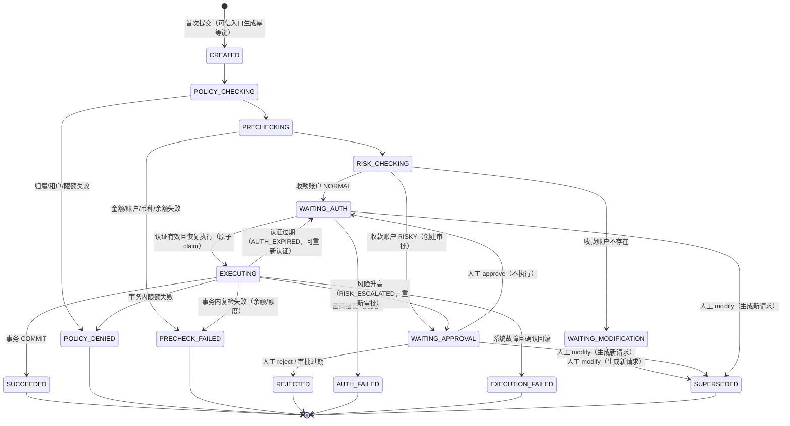

# Agent Tool Runtime on pi

本项目把阶段一的 LiteLLM 统一模型网关，升级为基于 pi 的 Agent 工具调用基础设施。模型、CLI、`pi-coding-agent` 扩展和审批 API 共用同一个 `ToolRuntime`；正式 MCP 连接 `my-coffee`。

在原有治理框架上，本项目新增了**模拟转账工具 `account.transfer`**（教学演示，不连接任何真实支付服务），完整展示"Agent 工具调用 → 治理 → 人工审批/修改 → 支付认证 → SQLite 事务 → 幂等与结果查询"的全链路。所有账户、密码、资金均为模拟数据。

## 1. 环境

- Python 3.12+
- Node.js 22.19+（使用内置 `node:sqlite`）
- DeepSeek API Key（仅真实 Agent 演示需要）
- 瑞幸 MCP Token（仅正式 MCP 演示需要）

```bash
cp .env.example .env
# 手工将四个值写入当前终端环境；项目不会自动读取或提交明文 .env。
export DEEPSEEK_API_KEY="..."
export GATEWAY_API_KEY="..."
export APPROVAL_API_KEY="..."
export LUCKIN_MCP_TOKEN="..."
```

## 2. 安装、构建与测试

```bash
python -m venv .venv
.venv/bin/pip install -e 'gateway[dev]'
cd runtime && npm ci && cd ..

cd runtime
npm run build     # TypeScript 编译
npm test          # 全部确定性单测（含转账 32 项 + 多进程并发 2 项），独立临时数据库，不污染演示数据
```

转账测试文件：

- `tests/unit/transfer.test.ts` — 正常链路、Schema/Precheck、权限与限额、审批/修改、认证、恢复重校验、幂等、故障注入、Agent 停止行为、Trace/Audit 脱敏、观测降级。
- `tests/unit/transfer-concurrency.test.ts` — **真实多进程并发**（`tests/fixtures/transfer-worker.ts` 独立进程、独立 SQLite 连接）：同 key 并发只产生一笔交易；不同 key 并发不透支、不突破每日额度。

```bash
cd ../gateway && ../.venv/bin/pytest    # Python Gateway 契约测试（与转账无关，保持原样）
cd ../runtime
npm run test:live     # 缺 DEEPSEEK_API_KEY 时必须失败，绝不回退到假模型
npm run test:mcp:live # 缺 LUCKIN_MCP_TOKEN 时必须失败
```

## 3. 模拟转账快速上手

以下命令均在 `runtime/` 目录执行（`npm run cli --silent -- <command>` 简写为 `cli`）。

### 3.1 初始化模拟账户

```bash
npm run cli -- accounts init          # 首次写入演示账户（已有数据则不动）
npm run cli -- accounts init --force  # 显式重置：清空账户、请求、流水、认证后重新写入
npm run cli -- accounts list          # 查看余额（整数分）
```

演示账户（`runtime/src/transfer/service.ts` 中的 `DEMO_ACCOUNTS`）：

| 账户 | 归属 | 余额（分） | 风险等级 | 用途 |
|---|---|---|---|---|
| `A` | trainer-1 / tenant_a | 1,000,000 | NORMAL | 默认转出账户 |
| `B` | trainer-1 / tenant_a | 0 | NORMAL | 正常收款 |
| `R` | trainer-1 / tenant_a | 0 | RISKY | 风险收款（触发人工审批） |
| `X` | 不存在 | - | - | 收款不存在（触发修改流程） |
| `FOREIGN` | trainer-2 / tenant_a | 50,000 | NORMAL | 越权转出测试 |
| `CBANK` | trainer-2 / tenant_b | 0 | NORMAL | 跨租户收款测试 |

### 3.2 正常转账（B：正常账户 → 等待认证 → 认证 → 成功）

```bash
# 1. 发起转账：A → B，100 元（金额参数单位为元，内部一律整数分）
npm run cli -- transfer submit A B 100
# => content: { transfer_request_id: "TR-...", status: "WAITING_AUTH", required_action: "authenticate" }

# 2. 隐藏输入模拟支付密码（演示密码 123456，输入不回显、不进 shell history、不进日志/数据库）
npm run cli -- transfer auth TR-xxxxxxxx
# => content: { status: "SUCCEEDED", transaction_id: "TX-...", from_account: "A***", ... }

# 3. 查询结果（只读；也可按幂等键查询）
npm run cli -- transfer status TR-xxxxxxxx
npm run cli -- accounts list
```

认证要求交互式终端，不接受管道或命令参数传递密码。自动验收使用临时数据库及 PTY 脚本 `python3 scripts/review-transfer-password.py`（在 runtime 目录运行）。

### 3.3 风险账户（R：等待人工审批 → 批准 → 仍需认证）

```bash
npm run cli -- transfer submit A R 50
# => status: "WAITING_APPROVAL", approval_id: "..."（复用 approvals 表，绑定用户/租户/参数摘要）

npm run cli -- transfer list                 # 待审批请求
npm run cli -- transfer approve TR-xxx --actor teacher
# => status: "WAITING_AUTH"（批准只解锁认证，绝不直接转账）

npm run cli -- transfer auth TR-xxx          # 认证后才真正执行
npm run cli -- transfer reject TR-xxx --actor teacher   # 拒绝：终态，无资金副作用
```

### 3.4 收款账户不存在（X：只能修改，不能审批放行）

```bash
npm run cli -- transfer submit A X 30
# => status: "WAITING_MODIFICATION"（没有审批可 approve；approve 会被拒绝）

npm run cli -- transfer approve TR-xxx --actor teacher
# => code: "REQUEST_NOT_EXECUTABLE"（收款账户不存在时不能通过审批跳过检查）

npm run cli -- transfer modify TR-xxx --to B --actor teacher
# => 生成全新请求（新幂等键、完整治理链路重跑），旧请求置为 SUPERSEDED，
#    旧审批、旧认证永久失效。若改到风险账户 R，新请求重新进入 WAITING_APPROVAL，
#    不会因旧请求曾获批而自动批准。
```

### 3.5 验证幂等：重复提交不重复扣款

`transfer submit` 缺省对“租户、用户、转出、收款、金额”计算 SHA-256，以 `demo:<摘要>` 生成确定性幂等键，避免账号进入 key。重复执行同一条命令会查询原请求；需要明确发起另一笔相同金额的转账时，请指定新的 `--key`。审计只保存 key 的摘要。

```bash
npm run cli -- transfer submit A B 20 --key idem-demo
npm run cli -- transfer auth TR-xxxxxxxx  # 替换为上一步请求编号，然后隐藏输入模拟密码
npm run cli -- transfer submit A B 20 --key idem-demo
# => 返回原交易结果，message 含"幂等命中"；accounts list 中 A 只扣了一次

# 同 key、不同参数 → IDEMPOTENCY_CONFLICT
npm run cli -- transfer submit A B 30 --key idem-demo
```

### 3.6 验证回滚与"提交后响应丢失"

故障注入通过环境变量（`TRANSFER_FAULT`）由测试/演示设置，**绝不暴露为模型工具参数**：

```bash
# 扣款后、提交前异常 → 全部回滚（余额不变、无流水，请求 EXECUTION_FAILED）
REQ=$(TRANSFER_FAULT=after_debit npm run cli --silent -- transfer submit A B 20 --key fault-1 | \
  python3 -c "import json,sys; print(json.load(sys.stdin)['content']['transfer_request_id'])")
TRANSFER_FAULT=after_debit npm run cli -- transfer auth "$REQ"
npm run cli -- accounts list   # A、B 余额均未变化

# COMMIT 成功后响应丢失 → 调用方 OUTCOME_UNKNOWN，数据库交易仍成功
REQ2=$(TRANSFER_FAULT=post_commit_drop npm run cli --silent -- transfer submit A B 20 --key fault-2 | \
  python3 -c "import json,sys; print(json.load(sys.stdin)['content']['transfer_request_id'])")
TRANSFER_FAULT=post_commit_drop npm run cli -- transfer auth "$REQ2"
# => code: "OUTCOME_UNKNOWN"（调用方观察状态，不是交易失败）
npm run cli -- transfer status fault-2
# => status: "SUCCEEDED" + transaction_id；再次 submit 同 key 不会二次扣款
```

### 3.7 从真实 Agent 入口触发

需要 Gateway 与 DeepSeek 凭据（缺少凭据时此步骤不运行，也不可用假模型冒充）：

```bash
# 终端 1：启动网关
GATEWAY_CONFIG=config/gateway.yaml \
  .venv/bin/python -m uvicorn app.main:app --app-dir gateway --host 127.0.0.1 --port 8000

# 终端 2（runtime/ 目录）：headless Agent
npm run cli -- agent "从账户 A 向账户 B 转账 100 元" --without-mcp
# 模型调用 account__transfer → 得到 WAITING_AUTH 结构化结果并向用户解释 → Loop 确定性停止
# 之后由人工执行 transfer auth <TR-...> 恢复；Agent 不会自行重试或换 key 重发。

# 交互式 Coding Agent 入口
npm run pi:managed -- --managed-user-id trainer-1 --managed-tenant-id tenant_a \
  --managed-roles supervisor --managed-mode execute
```

### 3.8 查看结果、Trace 与 Audit

```bash
npm run cli -- transfer list --status WAITING_AUTH
npm run cli -- transfer status TR-xxx
npm run cli -- trace <trace-id>        # 一次 Run 的完整执行过程
npm run cli -- audit --trace-id <trace-id>
npm run cli -- approvals list          # 复用的审批记录
```

关键 Trace 事件：`transfer.request.created` → `transfer.phase`（POLICY_CHECKING/PRECHECKING/RISK_CHECKING）→ `transfer.waiting` / `transfer.approval.created` → `transfer.auth.requested/succeeded/failed` → `transfer.execution.started` → `transfer.tx.committed` / `transfer.tx.rolled_back`（含未提交操作清单与原因）→ `transfer.idempotent.hit/conflict` / `transfer.result.unknown`。所有事件携带 `transfer_request_id`，成功后携带 `transaction_id`。

## 4. 治理链路与状态机

### 4.1 调用链

```text
Agent Tool Call (account__transfer)
→ ToolRegistry（名称映射）
→ Schema 校验（TypeBox：结构/类型/安全整数/multipleOf，拒绝额外参数）
→ PolicyEngine（Agent 白名单 / RBAC / plan 模式）            ← handler 之前
→ handler: TransferService.submit
   → 幂等路由（同 key 同参数 → 返回既有结果；不同参数 → IDEMPOTENCY_CONFLICT；
     同一 Agent Run 内已有转账 → TRANSFER_ALREADY_REQUESTED，阻止模型自主重试）
   → POLICY_CHECKING（转出归属 / 收款租户范围 / 单笔与每日限额）
   → PRECHECKING（金额>0 / 非同户 / 转出存在 / 币种 / 余额）
   → RISK_CHECKING（收款 NORMAL→WAITING_AUTH；RISKY→WAITING_APPROVAL；不存在→WAITING_MODIFICATION）
→ [人工审批 approve/reject/modify（受控入口）]
→ [支付认证 auth（受控入口，密码不回显）] → 统一恢复入口 runtime.invoke（沿用原幂等键与原参数）
→ 事务执行（BEGIN IMMEDIATE，见下）
→ Tool Result（结构化：成功/等待/失败均含 transfer_request_id 与状态）
```

事务内（`transfer/service.ts` `executeTransfer`，任一步失败 ROLLBACK，无单边扣款）：

1. 原子占用执行权（`WAITING_AUTH → EXECUTING`，仅一次）；2. 复核审批仍有效；3. 重读账户；4. 重做归属/限额/Precheck；5. 复核收款风险与批准条件一致（风险升高 → 回滚并重新审批）；6. 扣款（`UPDATE ... WHERE balance >= amount`）；7. 入账（账户/租户/币种一致性）；8. 写流水（`request_id` 唯一约束）；9. 置 SUCCEEDED；10. 原子消费认证与审批授权；11. COMMIT。审批与密码输入发生在事务之外，绝不持锁等待人工。

### 4.2 状态机



- **可恢复**：`WAITING_APPROVAL`（approve/reject/modify）、`WAITING_MODIFICATION`（modify/reject）、`WAITING_AUTH`（auth / modify）。
- **不可执行（终态）**：`SUCCEEDED`、`POLICY_DENIED`、`PRECHECK_FAILED`、`REJECTED`、`AUTH_FAILED`、`EXECUTION_FAILED`、`SUPERSEDED`。终态请求重复提交不会自动重新执行。
- `OUTCOME_UNKNOWN` 是**调用方观察状态**（响应丢失/超时后无法确认），不是请求状态；数据库请求状态与事务流水才是交易成败的判定依据。
- 恢复入口校验：请求属主（user/tenant）、状态处于可恢复态、参数摘要（`args_digest`）一致、认证/审批在有效期内且未被消费；恢复后在事务内重做全部业务校验，防止等待期间账户、风险或额度变化。

### 4.3 审批与认证、幂等与禁重试、调用失败与交易失败

- **审批 vs 认证**：审批（approve/reject/modify）是*人对这笔交易本身*的决定，绑定用户/租户/请求/参数摘要，由受控入口的 `--actor` 身本做出，一次性消费、有 TTL；认证（auth）是*证明操作者是他本人*的支付认证，绑定请求与参数摘要、有 TTL、在事务内一次性消费。风险账户两者都要：approve 只是解锁认证，绝不直接转账；正常收款账户只要求认证。
- **幂等 vs 禁止重试**：幂等由数据库唯一约束 `(tenant, user, idempotency_key)` + 事务保证——同 key 同参数最多成功一次，重复提交返回原交易；它不构成自动重试的理由：`maxRetries = 0`、无 fallback、写操作超时从不重试（沿用并保留既有修复），`OUTCOME_UNKNOWN` 后只允许查询，不允许自动重新执行。
- **调用失败 vs 交易失败**：`EXECUTION_FAILED` = 提交前故障且已确认回滚（钱没动）；`OUTCOME_UNKNOWN` = 调用方无法确认（响应丢失/超时），但数据库可能已成功——"调用超时"绝不等于"钱没转出去"，必须按原请求 ID/幂等键查询 `transfer_transactions` 这一事务性流水判定。

## 5. Demo 约束与信任边界（重要）

- **身份信任边界**：`userId`、`tenantId`、`roles`、审批/认证状态全部来自可信执行上下文与服务端记录；模型 Tool Args 中不存在这些字段，Schema 拒绝额外参数，`verified=true` 之类的自证一律无效。CLI 的 `--user-id/--tenant-id/--roles` 模拟"已认证的操作台身份"。
- **额度规则**（`config/platform.yaml` `transfer:`，单位整数分）：单笔上限 500,000（¥5,000）；每日上限 1,000,000（¥10,000），按转出账户统计当日已提交成功交易。**日界线为 UTC 日**（教学简化，非本地时区）。
- **租户范围**：Demo 只允许同租户转账（代码校验 `CROSS_TENANT_DENIED`），转出账户必须属于当前用户（`ACCOUNT_ACCESS_DENIED`）。
- **模拟认证限制**：密码 `123456` 仅是演示常量（配置文件 `demo_password`），仅做 SHA-256 定长比较，绝不写入 LLM Context、Tool Args、Trace、Audit、日志或数据库；真实系统应接入持牌支付认证服务。认证记录只保存"已通过"事实与有效期。
- **金额精度**：全部整数分运算；Schema 用 `multipleOf: 1` + 安全整数上下界拒绝非整数与溢出（`Type.Integer` 会被 pi-ai 的 `Value.Convert` 静默截断 100.5→100，故不可用）。
- **不是生产支付系统**：单机 SQLite、单币种 CNY、审批者与请求者未强制分离、无对账/清结算、模拟风控数据。它展示的是治理链路与一致性机制，不是支付合规实现。

## 6. pi 两种入口与既有功能

Headless 产品入口：

```bash
npm run cli -- agent "帮我完成任务"
```

交互式 Coding Agent 入口：

```bash
npm run pi:managed -- \
  --managed-user-id trainer-1 \
  --managed-tenant-id tenant_a \
  --managed-roles supervisor \
  --managed-mode plan
```

原有工具（`order.get_status`、`ticket.create`、MCP `my-coffee`）的审批与治理规则不受转账扩展影响；`ticket.create` 仍走静态 `requiresConfirmation` 审批流。

组合规则说明：`account.transfer` 配置为 `risk=high`、静态 `requiresConfirmation=false`、`maxRetries=0`、`idempotent=true`（由事务与幂等记录实际保证）、`executionMode=sequential`、**无 fallback**。静态策略不把正常收款账户送去人工审批；是否需要审批由 handler 内的收款账户风控动态决定（RISKY → WAITING_APPROVAL）。`sequential` 只是 Loop 内串行执行提示，不替代数据库并发控制。

## 7. 审批 API（既有）

```bash
curl -H "Authorization: Bearer $APPROVAL_API_KEY" http://127.0.0.1:8787/approvals?status=pending
curl -X POST -H "Authorization: Bearer $APPROVAL_API_KEY" \
  -H 'Content-Type: application/json' \
  -d '{"decision":"approve","actor":"teacher"}' \
  http://127.0.0.1:8787/approvals/<approval-id>/decision
```

注意：通用的 `/approvals/<id>/execute` 对转账只验证审批绑定并把原请求推进到 `WAITING_AUTH`，不占用或消费支付执行权、不移动资金；随后由账户属主通过 `transfer auth` 完成支付认证。审批 API 的共享 key 表示受信任的模拟操作台，不能作为真实多用户身份系统。

### 修复后的验收入口

在 `runtime` 目录执行：

```bash
npm run build
npm test
python3 scripts/review-transfer-password.py
# Gateway 已启动且凭据已导出时，真实调用 DeepSeek：
npx vitest run tests/live/transfer-review.test.ts
```

补充用例位于 `tests/unit/transfer-review.test.ts`，覆盖当前权限恢复、跨身份控制、授权绑定及过期、余额上界、严格金额类型、超时结果查询、终端与交互会话边界。原审核记录见 `docs/transfer-quality-review.md`，修复复测记录见 `docs/transfer-fix-verification.md`。

## 8. 安全约束（含转账）

- Tool Call 是候选动作，不是可信指令；Agent 只选择工具、生成参数、解释结果，不改余额、不定权限。
- 身份与权限来自可信上下文；审批/认证由服务端读取，模型无法自证。
- 账户字段部分脱敏（`A***`），密码与原始凭证不进入任何事件；通用审计层对 `from_account/to_account` 部分脱敏（`maskFields`），`sensitiveFields` 仍支持完全遮蔽。
- 观测（Trace/Audit）写入失败不会把已提交交易改写成回滚失败：降级告警输出到 stderr，成功结果带 `observability_degraded: true`；事务流水是成败判定依据。
- `my-coffee` 未知远端工具默认 `high` 风险并要求确认。
- Token 只从环境变量读取，审计层按敏感字段和通用密钥字段脱敏。
- 只有幂等且可重试的调用才自动重试；写操作超时不重试；流式输出已发出后不切换模型。
- pi Hook 修改后的参数不会由 pi 自动重验，因此 handler 前统一由 `ToolRuntime` 再验证。

## 9. 亲手验收清单

前置：`cd runtime && npm run build && npm test`（应 43 项全绿），然后依次执行并对照预期：

| # | 操作 | 预期观察 |
|---|---|---|
| 1 | `npm run cli -- accounts init --force` | 输出 5 个账户，A=1,000,000 分 |
| 2 | `npm run cli -- transfer submit A B 100` | `WAITING_AUTH` + `required_action: authenticate` |
| 3 | `npm run cli -- transfer auth <TR-id>`（输入 123456） | `SUCCEEDED` + `TX-*`；`accounts list` 中 A=990,000、B=10,000 |
| 4 | 再执行一次第 2 步命令 | `SUCCEEDED`、message 含"幂等命中"；余额不再变化 |
| 5 | `npm run cli -- transfer submit A R 50` | `WAITING_APPROVAL` + `approval_id` |
| 6 | `npm run cli -- transfer approve <TR-id> --actor teacher` | `WAITING_AUTH`（未转账，R 余额仍 0） |
| 7 | `npm run cli -- transfer auth <TR-id>` 输错密码 `000000` | `AUTH_FAILED`，请求终态，余额不变 |
| 8 | `npm run cli -- transfer submit A X 30` | `WAITING_MODIFICATION`；对其 approve 返回 `REQUEST_NOT_EXECUTABLE` |
| 9 | `npm run cli -- transfer modify <TR-id> --to B --actor teacher` | 新请求 `WAITING_AUTH`；旧请求 `SUPERSEDED`（`transfer status` 可见 `superseded_by`） |
| 10 | `npm run cli -- transfer submit FOREIGN B 10` | `ACCOUNT_ACCESS_DENIED`（越权转出） |
| 11 | `npm run cli -- transfer submit A B 60 --roles support` | `RBAC_DENIED`（角色无 `account:transfer`） |
| 12 | 3.6 节 `TRANSFER_FAULT=after_debit` 序列 | `EXECUTION_FAILED`，余额与流水全部回滚；`trace` 中有 `transfer.tx.rolled_back` |
| 13 | 3.6 节 `TRANSFER_FAULT=post_commit_drop` 序列 | 调用方 `OUTCOME_UNKNOWN`；`transfer status <key>` 得 `SUCCEEDED`；重复提交不二次扣款 |
| 14 | `npm run cli -- trace <trace-id>` / `npm run cli -- audit` | 事件按 `transfer.*` 关联请求 ID；全库 grep 不到明文密码 `123456` |
| 15 | （有 DeepSeek 凭据时）3.7 节 agent 命令 | 模型解释 `WAITING_AUTH` 后 Run 以 `TRANSFER_WAITING` 停止；无凭据则此步跳过 |

## 10. 代码导览

| 文件 | 职责 |
|---|---|
| `runtime/src/transfer/tool.ts` | `account.transfer` 工具定义：TypeBox Schema（multipleOf 防截断）、risk=high/maxRetries=0/无 fallback、handler 将结构化失败转为 `ToolRuntimeError(details)` |
| `runtime/src/transfer/service.ts` | 状态机与编排：幂等路由、Run 内重试门、Policy/Precheck/Risk 推进、审批/修改/认证受控入口、事务执行与故障注入、观测降级 |
| `runtime/src/transfer/store.ts` | 转账领域表（accounts/transfer_requests/transfer_transactions/auth_records）、`BEGIN IMMEDIATE` 事务、原子状态流转 SQL（claim/supersede/consume） |
| `runtime/src/transfer/policy.ts` | 转出归属、收款租户范围、单笔/每日限额（静态 PolicyEngine 之外的业务策略层） |
| `runtime/src/runtime.ts`（扩展） | `idempotencyKey` 透传、失败结果携带 `details`、`maskFields` 部分脱敏、结果确定后观测写入非致命 |
| `runtime/src/loop-guard.ts` / `pi/agent-runner.ts`（扩展） | 等待转账时确定性停止 Loop（`TRANSFER_WAITING`） |
| `runtime/src/cli.ts`（扩展） | `accounts` / `transfer` 命令组、隐藏密码输入、元→分解析 |
| `runtime/tests/unit/transfer*.test.ts` + `fixtures/transfer-worker.ts` | 32 项确定性验收 + 2 项多进程并发验收 |
